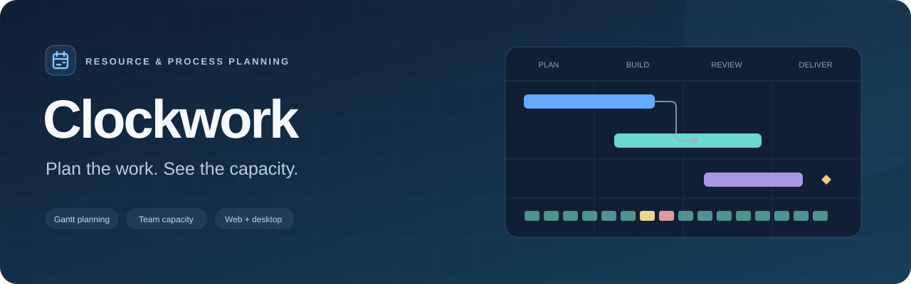
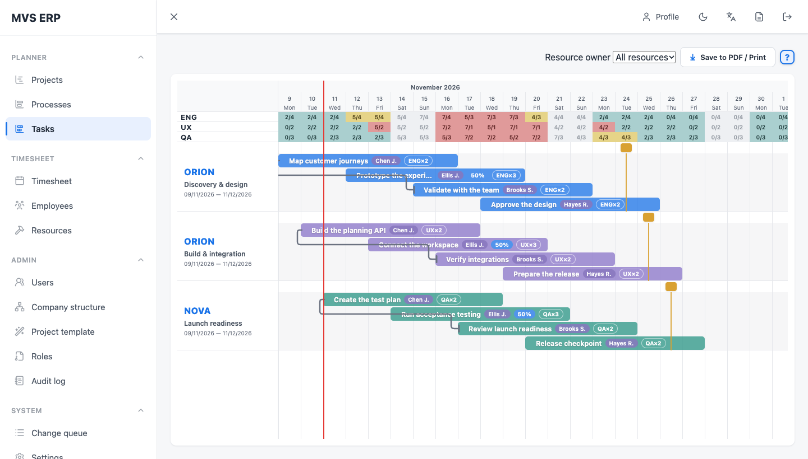
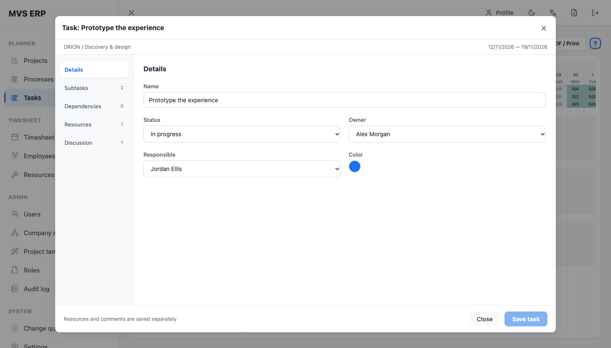
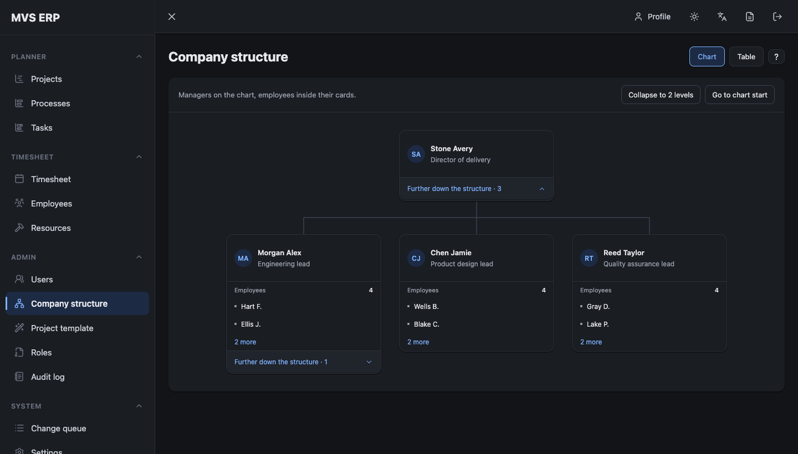

  

  
  
  
  
  

  <strong>Projects, processes, tasks and people — on a shared timeline.</strong> 
  Clockwork helps managers turn plans into schedules that account for real team capacity.

  <a href="#planning-with-capacity-in-view">Planning</a> ·
  <a href="#one-task-one-workspace">Task workspace</a> ·
  <a href="#a-clearer-picture-of-the-team">Team structure</a> ·
  <a href="#more-than-a-timeline">More features</a>

## Planning with capacity in view

See the schedule and available resources together. Move tasks, adjust their
dates and spot overloads in the resource header, without switching screens.

- **Three planning levels.** Navigate between projects, processes and tasks while
  keeping the calendar position, zoom and selected time unit.
- **Days and ISO weeks.** Switch between detailed daily planning and a weekly
  overview; weekly resource cells show peak load and minimum availability.
- **Dependencies and milestones.** Connect tasks, track checkpoints and see the
  relationships directly on the chart.
- **Useful information on the bars.** Configure badges for owners, responsible
  people, resources and subtasks. Filter resource rows and their badges by owner.

## One task, one workspace

Task details, assigned resources, subtasks, dependencies and discussion live in
one large window. Move between sections without juggling separate dialogs.

## A clearer picture of the team

Explore the company through manager cards and compact employee lists. Start with
two levels, expand a branch when needed, or switch to the table view.

## More than a timeline

| Capability | What it brings to planning |
| --- | --- |
| **Timesheets and absences** | Employee availability feeds the resource calendar, so time away is reflected in capacity. |
| **Roles and permissions** | Control viewing and management separately, with ownership rules, inherited viewing and individual overrides enforced by the backend. |
| **PDF and printing** | Export the current date window and scale with its colors and badges; choose the content to include. `Ctrl/Cmd+S` and `Ctrl/Cmd+P` open print preparation. |
| **Offline work and synchronization** | Cached data stays available during a connection loss. Supported changes are queued locally and synchronized when connectivity returns. |
| **Browser and desktop** | The same Vue interface runs on the web and inside Electron. |
| **Light and dark themes** | Choose the appearance and switch between English and Russian. |

Screenshots show the current application with fictional demonstration data.

---

**Docker images:** [Frontend](https://hub.docker.com/r/koshsky/erp-frontend) ·
[Backend](https://hub.docker.com/r/koshsky/erp-backend)

**Contributing:** setup, checks, repository layout and branch workflow are in
[AGENTS.md](AGENTS.md).

**Previously:** [erp-frontend](https://github.com/Koshsky/erp-frontend) ·
[erp-backend](https://github.com/Koshsky/erp-backend).
Clockwork combines both projects; their earlier history remains in those repositories.
