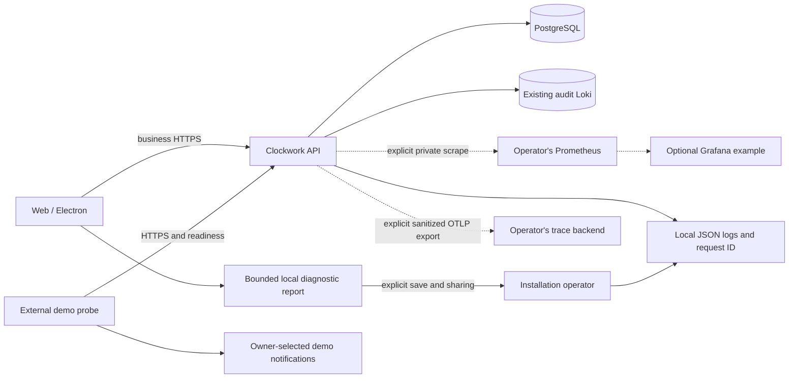

# Self-hosted diagnostics and demo monitoring

O01 design, revised 2026-11-18 for an open-source self-hosted product with a public
demonstration instance. This supersedes the earlier full-stack proposal in commit
`7de11fd`. Planning only: no instrumentation, service installation, access change,
release or deployment is authorized by this document.

Tracker: [epic](http://localhost:3456/tasks/93), [O01](http://localhost:3456/tasks/94).

## Product boundaries

Clockwork must be installable and diagnosable without an additional observability
stack. An operator can use their existing tools or explicitly enable integrations.
No diagnostic data is automatically sent to the developers or third parties by
default. Routine business API traffic to the user's configured server is separate
from diagnostic reporting.

The demonstration instance, `erp.koshsky.ru`, has its own operating checks. Its
infrastructure, notification routing and availability targets do not become
requirements or promises for other installations.

| Scope | Deliverable |
| --- | --- |
| Built-in product diagnostics | Safe structured logs and request IDs; meaningful outcome codes; liveness/readiness; local Electron queue status and bounded logs; user-triggered sanitized support report |
| Optional integrations | Private Prometheus-compatible metrics, explicitly enabled OTLP export, a separate Prometheus/Grafana example and at most two initial dashboards |
| Our demo instance | Lightweight external HTTPS/TLS/readiness check, host/DB/disk checks and a few actionable notifications; enablement needs a separate instruction |

No additional VPS, technical Loki, Alloy, Tempo, mandatory client SDK, diagnostic
intake service or fleet analytics is required. Existing audit Loki remains an
application dependency with its existing data/access contract; this plan neither
removes it nor changes its retention. Continuous profiling, HA, object storage,
tail sampling, a second alert engine and a universal SLO framework are out of scope.

## Existing evidence

Repository baseline: `main` at `2ba6039049638a97ee7a80c7bf55f830a0848082`,
backend 1.6.0 / frontend 2.2.0.

- [Structured logging](../backend/internal/logger/context_handler.go) already
  attaches request/trace IDs. [Request logs](../backend/internal/server/app.go)
  provide status and duration. Extend the existing logger instead of adding one.
- [Tracing setup](../backend/internal/tracing/setup.go) has optional batched OTLP
  and head sampling. O02 sanitizes [HTTP spans](../backend/internal/middleware/tracing/tracing.go)
  and [pgx spans](../backend/internal/tracing/pgx_tracer.go); O04 adds explicit TLS/auth,
  public W3C links and fixed export limits. Both supplied configurations disable tracing.
- [Audit sender](../backend/internal/audit/sender.go) has two 1,024-event in-memory
  queues and bounded retries. `Dropped()` does not cover all failure paths. Even
  synchronous `Enqueue` logs/ignores send errors; instrumentation is not durability.
- The [audit client](../backend/internal/audit/client.go) uses a default 30-day
  query window. That is not retention: [Loki configuration](../deploy/production/loki.yaml)
  does not explicitly expire audit data. Preserve the journal and its RBAC.
- [Health](../backend/internal/server/routes.go) is liveness, also used by clients
  for connectivity. Add separate bounded readiness without changing that contract.
- [Electron synchronization](../frontend/desktop/sync-service.cjs) and the
  [command queue](../frontend/desktop/command-queue.cjs) own business delivery.
  Diagnostics must neither replace their state nor introduce a second outbox.
- [Production Compose](../deploy/production/compose.yml) already has five services
  and no explicit logging rotation. Preserve volumes, network, Caddy's reserved
  IP and the tested deployment order.

A read-only O01 inventory on 2026-11-18 at 13:00 UTC found 1 vCPU, 1.922 GiB RAM
(1.438 GiB available) and an 18.729-GiB filesystem (10.539 GiB available). This was
an idle snapshot, not capacity evidence. No new server inspection or change is
needed to revise this plan; baseline traffic/peak measurements remain future work.

## Minimal diagnostic flow

Built-in diagnostics do not make network calls to a collector. The support report
contains versions, controlled error/outcome codes, request IDs and relevant local
status; never tokens, cookies, names, comments, raw URLs/query, SQL values, the
credential vault or a copy of SQLite. Saving/sharing is an explicit user action.

Web diagnostics use a bounded in-memory error history, not a new offline runtime.
Electron has bounded rotated files and a previewable support bundle. Account/server
changes cannot mix diagnostic contexts. Optional client upload is deferred; do not
create an always-running reporting queue or server intake just to collect errors.

Optional endpoints are private and explicitly configured. Absence of a scraper,
exporter receiver or Grafana must not affect startup, CRUD, navigation, PDF/printing
or command replay. Export queues/timeouts are bounded; IDs stay in event fields,
not metric labels. Remote export requires TLS/auth and an operator-selected
recipient. Tracing is off by default; incoming sampling flags must not bypass
limits. Head sampling does not guarantee preservation of every error.

## Measurements, targets and resource guardrails

SLIs describe API errors/latency and the known outcomes of logical commands after
reconnection. They are useful diagnostic measurements, not a requirement to deploy
a full monitoring platform. Count a logical operation once, not once per retry;
an optimistic UI update is not server acknowledgement. Use durable receipts to
resolve lost responses, and distinguish applied, rejected, conflict and unknown.

Expected authorization/validation/conflict responses, deliberate user offline,
sleep and reauthentication differ from an unexpected server fault. Report active
delivery time and wall-clock age separately. A server failure after delivery starts
must not disappear from measurement by classifying every 5xx as normal offline.
No traffic or missing telemetry is not a green 100% success interval.

There is no universal availability SLO or SLA for installations on unknown hardware.
Choose at most a few demo/workload targets after measuring a known configuration;
record the denominator, workload and limitations. The previous 99.9% availability
and 120-second delivery proposals are not adopted requirements. No contractual
availability or round-the-clock human response is promised by this plan.

The following are initial acceptance guardrails, **not measured results or product
minimum system requirements**. Validate with equivalent representative workloads
and revise explicitly if they are unsuitable:

| Scope | Initial guardrail |
| --- | --- |
| Required new monitoring processes | Zero |
| Additional backend diagnostic memory | <=32 MiB |
| Additional Electron diagnostic memory | <=16 MiB, separate from total application memory |
| Additional average CPU | <=3% of one CPU core under the stated test workload |
| Request p95 regression | <=5% versus equivalent baseline, with variability reported |
| Electron diagnostic files | <=20 MiB total and seven days, whichever limit comes first |
| Manually generated support bundle | <=10 MiB; explicit destination, bounded temporary files |
| Docker logs in supplied Compose examples | <=30 MiB per container; recount services, retain ordinary `docker logs` access |
| Web error history | <=50 records, <=2 KiB each; deduplicate and sanitize |
| Optional Prometheus/Grafana example | Initially <=1 GiB RAM / <=2 GiB total metric and state disk; <=2,000 active series, 30s scrape, up to seven days |

The optional example is not enabled by ordinary Compose/deploy. Its disk budget
must include WAL, head, indexes, compaction and Grafana state, with a lower block
retention limit and reserve; time retention is not a hard byte quota. Measure
actual behavior in O10/O14, including full disk/restart. Reduce scope or agree a
new budget if it does not fit; do not silently increase resources or advertise
these targets as guaranteed on every machine. No provider subscription is needed
for the basic product, and no budget for a new VPS is assumed.

Audit history, PostgreSQL data and server-only backups are outside diagnostic
rotation. No deletion, retention change, data migration or transactional audit
outbox is hidden in this epic. Report known audit-delivery failures honestly;
a process crash can lose in-memory events without a surviving loss counter.

## Demo checks

Use a simple independent external checker for HTTPS/TLS/readiness, together with
existing or lightweight host checks for disk/inodes, RAM, database readiness and
actual deployed versions. A checker on the application VPS cannot alone detect
loss of that VPS. Choose its location, notification channel and responder with
the owner; no additional paid server is implied. Document how to notice a failed
checker, without requiring an HA monitoring installation.

Start with unavailable demo, low disk, database not ready and expiring TLS.
Notifications need debouncing, recovery and a short runbook, not a fleet-wide
burn-rate policy. Reuse existing deploy/audit signals without duplicate alerts.
A backup-age alert requires an agreed backup schedule; successful creation and
verified restore are distinct facts. Ordinary Electron offline and expected
403/409 must not generate server incidents.

Keep `/health` semantics, add separate readiness with a bounded database/schema
check, and exclude auxiliary monitoring failures from business readiness. Responses
must not leak DSNs/internal errors, and probes must not consume user rate budgets.
Existing acceptance tests cover SPA/chunks/navigation; a permanent browser runner
or synthetic login using bootstrap admin credentials is not required.

## Tasks and sequencing

| Task | Revised deliverable | Dependencies |
| --- | --- | --- |
| [O01](http://localhost:3456/tasks/94) | This light architecture and product/demo boundaries | Design review |
| [O02](http://localhost:3456/tasks/95) | Safe fields, redaction, privacy and explicit export policy | O01 |
| [O03](http://localhost:3456/tasks/96) | Useful local server logs and bounded rotation | O02 |
| [O06](http://localhost:3456/tasks/99) | Local operation/receipt/audit-delivery outcomes | O02/O03 |
| [O13](http://localhost:3456/tasks/106) | Compatible liveness, separate readiness, demo probe configuration | O02 |
| [O08](http://localhost:3456/tasks/101) | Compact local web error report | O02/O03/O06 |
| [O09](http://localhost:3456/tasks/102) | Local Electron logs, queue diagnostics and sanitized bundle | O02/O06 |
| [O07](http://localhost:3456/tasks/100) | Lightweight demo resource/deploy/backup checks | O01/O02/O13 |
| [O12](http://localhost:3456/tasks/105) | A few demo notifications and response notes | O07/O13; owner selects actual channel |
| [O05](http://localhost:3456/tasks/98) | Small optional private metrics endpoint | O02; expose O06 signals as available |
| [O04](http://localhost:3456/tasks/97) | Safe optional OTLP integration, no bundled production trace store | O02/O03 |
| [O10](http://localhost:3456/tasks/103) | Separate optional Prometheus/Grafana example | O02/O05 |
| [O11](http://localhost:3456/tasks/104) | At most two optional dashboards and a log-first troubleshooting guide | O03/O05/O06/O10 |
| [O14](http://localhost:3456/tasks/107) | Focused acceptance, overhead measurements and operator instructions | Incremental for each delivered scope |

The first milestone is built-in diagnostics plus prepared demo checks. It does not
wait for metrics, tracing or Grafana. The integration milestone supplies optional
artifacts and their tests; it does not require deploying them on our demo. All 14
task IDs/parent relationships remain. Complete the epic when both agreed scopes
are delivered, or explicitly remove deferred work with the owner; do not close
unfinished tasks merely because their feature is optional for users.

Acceptance reuses existing login/navigation, Gantt/day/week, PDF, two-window,
offline/reconnect and lost-response scenarios, adding assertions only for new
diagnostic behavior. Compare default, local-diagnostics and optional-export modes.
Inject unavailable exporter, rotation/quota, disk and diagnostic failures; verify
privacy, bounded resources and unchanged business behavior. Record tested OSes
and limitations. There is no mandatory week of production monitoring before a
local diagnostic change can be accepted.

O01 remains under review in Doing. All other statuses are preserved. Implementation,
GitHub changes, notification tests, release and demo deployment need separate
instructions; no part of revising the plan performs them.

O02 implementation contracts are documented in [Diagnostic data](diagnostic-data.md).

O03 server logging and rotation: [Operator guide](server-logs.md).

O04 optional tracing, trust boundaries and resource limits: [Operator guide](tracing.md).

O05 optional private backend metrics and interpretation: [Operator guide](metrics.md).
