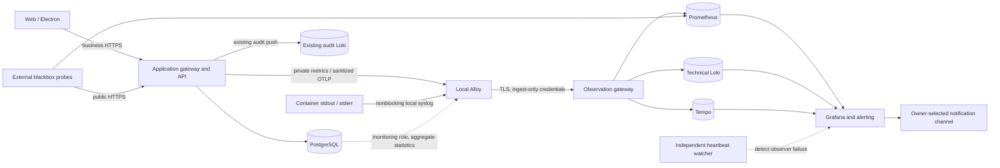

# Observability architecture and operating budget

Status: O01 design proposal, 2026-11-18. Implementation and expenditure require
separate approval. No application, deployment, access or release changes are part
of this document. Tracker: [O01](http://localhost:3456/tasks/94),
[observability epic](http://localhost:3456/tasks/93).

## Evidence and boundaries

Repository baseline: `main` at `2ba6039049638a97ee7a80c7bf55f830a0848082`,
backend 1.6.0 and frontend 2.2.0. Repository configuration is evidence of the
intended deployment, not proof of every live setting.

A read-only resource inventory over the existing root SSH connection on
2026-11-18 at 13:00 UTC found:

| Item | Observed value |
| --- | --- |
| Application VPS | 1 vCPU, 1.922 GiB RAM, 2.000 GiB swap |
| Available RAM | 1.438 GiB; swap is not a capacity allowance |
| Filesystem containing `/opt/erp` | 18.729 GiB total, 10.539 GiB available |
| Inodes | 5,010,320 total; 4,939,407 available |
| Load average, 1 / 5 / 15 minutes | 0.291 / 0.164 / 0.125 |
| Container memory, Docker working-set view | db 38.46, backend 17.72, frontend 3.48, Caddy 12.08, Loki 47.63 MiB |
| Default Docker logging driver | `json-file` |

This is one mostly idle snapshot, not a peak, leak test, disk-growth estimate or
capacity benchmark. Docker's memory view is not total host memory consumption.
Per-container logging overrides, actual log/volume sizes, traffic, provider
pricing and available independent infrastructure have not been inventoried.
Sanitized raw evidence stays outside Git in the local O01 working directory;
no credentials, database dumps or customer data were collected.

Verified source contracts:

- [Production Compose](../deploy/production/compose.yml) contains PostgreSQL,
  backend, frontend/nginx, Caddy and Loki. Preserve external volumes, the
  `erp_app-network` network, Caddy's reserved IP and container recreation order.
- [Backend configuration](../deploy/production/backend.yaml) uses JSON info logs,
  disables tracing/profiling, limits requests to 10 seconds and bounds the pgx
  pool at 25 connections. Redis is disabled.
- [Request logging](../backend/internal/server/app.go) includes method, actual
  path, status, duration and request ID. Request and trace IDs already connect
  [structured logs](../backend/internal/logger/context_handler.go).
- [HTTP spans](../backend/internal/middleware/tracing/tracing.go) use actual paths
  and `RequestURI`; [pgx spans](../backend/internal/tracing/pgx_tracer.go) include
  SQL and raw errors. Do not export these unchanged: O02 precedes enablement.
- [Tracing setup](../backend/internal/tracing/setup.go) already supports batched
  OTLP/gRPC and parent-based head sampling. Its insecure transport is local-only;
  authenticated TLS is required for cross-host export. Local Compose has Jaeger.
- [Health](../backend/internal/server/routes.go) always reports liveness without
  querying the database and is used by clients for connectivity. Preserve this
  API. Readiness and authenticated synthetic reads are additional probes.
- [Audit sender](../backend/internal/audit/sender.go) has two 1,024-event memory
  queues, three background attempts and a separate one-second synchronous send.
  Overflow increments `Dropped()`, but exhausted delivery attempts, ignored inline
  errors and shutdown losses are not all represented by that counter.
- [Audit client](../backend/internal/audit/client.go) uses Loki streams with
  `service="erp", kind="audit"`. Its default 30-day query window is not retention.
  [Loki configuration](../deploy/production/loki.yaml) has no explicit retention.
- [Electron synchronization](../frontend/desktop/sync-service.cjs) is owned by the
  main process, with a 60-second refresh interval. Business commands and receipts
  remain separate from disposable diagnostic telemetry.

## Decision: a small independent observation host

Propose a separate observation VPS with **2 vCPU, 4 GiB RAM and 40 GiB SSD**.
Leave only **one Alloy agent** on the application VPS. Do not install the complete
stack on the existing 1-vCPU application host based on its idle free-memory figure.
No machine has been ordered and no services have been installed.

| Component | Responsibility and decision |
| --- | --- |
| Grafana Alloy, application host | Local metrics scrape, embedded Unix/PostgreSQL exporters, sanitized log collection and OTLP forwarding; one agent instead of three separate collectors |
| Prometheus, observation host | One instance, local TSDB, 30-day metrics; receives authenticated remote write from Alloy and scrapes local probe/store health |
| Loki, observation host | One small single-binary store for technical logs only, seven-day retention |
| Tempo, observation host | One monolithic trace store, three-day local retention; Grafana trace lookup by trace ID |
| Grafana, observation host | Dashboards and the single alert-rule/notification engine; no second Alertmanager/ruler rule set |
| Authenticated gateway, observation host | TLS and method/path-specific ingestion authorization; separate operator login for Grafana |
| Blackbox exporter, observation host | Public DNS/HTTPS/TLS and liveness/readiness checks from outside the application VPS |
| Existing Loki, application host | Existing audit journal only; preserve its volume, API, query selectors and retention behavior |

Two Loki instances are intentional: adding short-lived technical logs to the
existing unauthenticated audit store would share disk, ingestion pressure and
retention administration with application data. Reusing it saves a process, but
requires a separately verified audit retention/access contract. It is not the MVP
choice. No audit records are migrated, copied to Grafana or expired by this plan.
The existing audit store's unbounded growth remains an explicit operational risk,
not a problem silently solved by technical-log retention.

The business HTTPS connection does not imply diagnostic uploads: web and
Electron diagnostics get a bounded, allowlisted application intake in O08/O09,
never store ingestion credentials. They are not dependencies of login, navigation,
CRUD, rendering, printing or command synchronization.

### Alternatives and scope

| Alternative | Disposition |
| --- | --- |
| Entire stack on current VPS | Local experiment only. Couples failure domains and competes with PostgreSQL/requests; requires peak testing before any limited deployment |
| Remote full stack | Preferred first production design; one additional host and simple stores, no cluster |
| Managed observability | Viable if the owner prefers subscription, data-region and egress terms; not assumed or purchased |
| VictoriaMetrics instead of Prometheus | Reconsider if measured series/retention costs require it; no second metrics store in MVP |
| Jaeger instead of Tempo | Existing local Jaeger stays for development. Tempo gives one Grafana trace workflow; no dual production trace stores |
| OTel Collector instead of Alloy | Viable equivalent, but Alloy combines the selected log and embedded-exporter paths; do not run both agents |
| Mimir, Kafka, Kubernetes, object storage, HA replicas, service graph generator, continuous profiling | Deferred until a measured need; none is required for these traffic assumptions |

Tempo's monolithic mode and local storage suit a small diagnostic deployment,
with single-host data-loss risk [S3]. This is not an HA monitoring service. The
observation host must have a separate failure domain where practical. An external
heartbeat watcher must also detect loss of that host; a machine cannot alert
reliably about its own complete outage. A channel and independent watcher location
are owner decisions, not assumed existing services.

## Collection, access and failure contracts

- Backend metrics bind privately; no public `/metrics`, pprof, Docker API, Loki,
  Tempo, Prometheus or Alloy management port. Do not route ingestion through the
  business API or make business readiness depend on it.
- Prefer Docker's nonblocking RFC5424 **UDP** syslog output to an Alloy receiver
  published on host loopback only. It avoids mounting the Docker socket or
  reading Docker's private log files. Keep a bounded dual-logging cache so `docker logs` remains
  usable [S5]. Test startup with the receiver absent, restart/reconnection, full
  buffers and container recreation in O10; reject this transport if it prevents
  application startup. Default `json-file` is not changed in O01.
- Per-container local cache proposal: 3 x 10 MiB; log delivery buffer 1 MiB each.
  Agent/container failures may lose diagnostic logs. Never promise cache replay
  or exactly-once log delivery. UDP loss can be unobservable per event; report
  collection gaps and health rather than claiming an exact lost-event count.
  No blocking remote logging driver in requests.
- Alloy embeds Unix/PostgreSQL exporters [S6]. Mount only required host views
  read-only, never the Docker socket, whole root filesystem or production env.
  PostgreSQL uses a dedicated monitoring role and an allowlist of aggregate
  queries, no superuser, SQL text or bind parameters. Timeout queries and bound
  monitoring connections separately from the application pool.
- Cross-host ingress uses TLS with separate scoped credentials, request/rate/body
  limits and an allowlisted source. Grafana query/admin access uses different
  credentials. Remote-write ingestion cannot access query/delete/admin endpoints.
  Local OTLP may remain on a private network; remote insecure gRPC may not.
- Gateway and source sanitization reject tokens, cookies, passwords, names,
  comments, request/response bodies, arbitrary URLs and SQL/errors containing
  values. Only route templates, controlled error codes and reviewed attributes
  leave the application. Existing audit is governed by its own application RBAC.
- Operators administer telemetry; application administrators do not automatically
  receive infrastructure credentials. Grafana data sources do not bypass RBAC to
  expose the existing audit store. Store secrets outside Git, separate per host.
- SDK batching and bounded agent queues never hold application/queue commit locks.
  Full queues drop diagnostics and increment loss metrics, with backoff. Persistent
  metric WAL is bounded in time and disk; it is not a business outbox [S4, S7].
  Do not claim Loki writes or trace exports have the same WAL guarantees.
- On observation-host outage: CRUD and Electron continue, local bounded logs remain
  available, drops/backlog are observable after recovery. Missing samples remain
  gaps, never zeros or success. Alert `No Data`/evaluation errors explicitly [S8].
- Use one Grafana alert engine. Prometheus recording rules may precompute SLI
  windows, but neither Prometheus, Loki nor Tempo sends duplicate notifications.

## Signal catalog and ownership

The owner names below are operational roles, not newly created accounts. Until a
team is assigned, the server administrator is the responder and the relevant
service maintainer owns fixes. Request/trace IDs are log fields, never labels.
Metric names and exact schema are finalized/tested in O02/O05, not declared APIs.

| Diagnostic question / signal | Collection point | Owner / initial action condition |
| --- | --- | --- |
| Can a user reach and enter the app? | External DNS/TLS/HTTPS + SPA asset check; dedicated low-privilege synthetic login/read in O13 | Server admin + backend/frontend; three consecutive failed one-minute probes |
| Is API serving correct requests promptly? | Edge upstream failures + backend route/status/outcome counters and fixed-bucket histograms | Backend; SLO burn or sustained eligible failures |
| Why is a request slow? | Correlated request logs, HTTP/service/pgx spans, pool wait/usage and timeout metrics | Backend; planning latency SLO or pool exhaustion |
| Did a write commit despite a lost response? | Logical operation/receipt lookup, guarded replay outcome and revision/conflict counters | Backend + desktop; unresolved outcome/backlog after healthy reconnect |
| Is Electron working locally? | Main/worker bounded logs; pending count/bytes/oldest, rejected/conflict/blocked counts, replay/pull outcomes | Desktop; local queue status first, server alert only for opted-in eligible stalled clients |
| Is a frontend page failing? | Vue/unhandled/chunk errors, navigation/login/planning/PDF timing and bounded diagnostics intake | Frontend; repeated sanitized error signature + affected-session rate |
| Is the audit journal losing events? | Queue length/age; overflow, exhausted retry, inline failure and shutdown-loss counters; Loki health | Backend + server admin; any confirmed loss, or sustained delivery failure |
| Is the host/DB nearing failure? | Unix metrics, aggregate PG connections/locks/transactions, filesystem/inodes, service heartbeat/restarts | Server admin; resource thresholds below |
| Did deployment/backup succeed? | Deploy job result, manifest/digests, verified backup timestamp/size and restore-test timestamp | Server admin; deployment failure or a missed explicitly scheduled backup |
| Is observation itself healthy? | Scrape/remote-write freshness, queue/drop/store counters, external observer heartbeat | Server admin; missing telemetry, observer outage or quota pressure |

MVP infrastructure uses host metrics, service health, aggregate PostgreSQL metrics
and collector self-metrics. Full per-container cgroups/CPU/RSS/restarts need an
allowlisted host adapter or reviewed exporter in O07, separately budgeted. Do not
add privileged cAdvisor or grant Docker control just to fill dashboard panels.

## SLI definitions and proposed SLOs

These are **provisional engineering targets**, not agreed customer SLAs or proof
of current performance. Collect at least seven representative days, including a
busy planning session and a deployment; then approve targets before paging. Use
rolling 30-day windows; annotate deployments/maintenance without silently removing
their failures. Unknown/missing data is reported separately with measurement
coverage; an incomplete month is not advertised as compliant.

| SLI | Good / eligible events | Initial target |
| --- | --- | --- |
| External availability | Successful one-minute DNS + TLS + HTTPS app/liveness/readiness probe slots / scheduled slots | >=99.9% in 30 days; 43.2 failed minute slots exhaust the budget |
| API availability | Non-fault eligible API responses / all eligible requests | >=99.9%; measure edge failures as well as backend responses |
| API latency, CRUD / auth / planning | Successful eligible responses within 0.5 / 1 / 2 seconds / successful eligible responses in that class | >=95% for each class; histogram buckets must include these thresholds |
| Electron command delivery | Distinct logical commands reaching a known terminal server outcome within 120 seconds / eligible logical commands | >=99%; also report outcomes taking over 10 minutes and successful-apply ratio |
| Telemetry freshness | Fresh expected target samples / scheduled target scrapes | >=99% within 90 seconds; telemetry SLI, not business availability |

Availability classifications:

- Exclude health/metrics/probes/static files, unknown-route scans and documented
  validation/authorization/conflict outcomes from the API business denominator.
  Keep separate raw status counters and reject rates so exclusions cannot hide a
  regression. Valid synthetic login/read failure is always a failed probe.
- Include application 5xx, timeouts, edge 502/503/504 and internal application-error
  envelopes even if HTTP is 200. Do not double count the same edge/backend request;
  use the edge as the eventual API boundary, with backend SLI as a drill-down.
  O05 must define coverage until edge instrumentation is available.
- Distinguish intentional anti-abuse 429 from capacity-caused rejection of valid
  traffic. Unclassified capacity failures are bad, not silently excluded. Track
  client cancellation separately; server-caused timeouts remain bad.
- Low traffic yields unstable percentages. A zero-request window is undefined,
  not 100% successful. Use external probes plus absolute failure counts; do not
  page from one expected rejection or a p95 computed from two requests [S9].

Electron eligibility and outcome rules:

- A logical command is counted once, not once per retry. Start timing when the
  client has a valid session, a compatible/reachable server and the command is
  locally ready; queued offline commands become eligible on that transition.
- Report active delivery time and wall-clock age separately. Suspend active time
  during confirmed user offline, OS sleep/app shutdown or explicit reauthentication
  need; show these blocked states. A server failure after eligibility starts does
  not pause time just because requests fail. Do not infer offline from every 5xx.
- A persisted receipt / verified replay after a lost response is a known outcome.
  An optimistic UI update alone is not acknowledgement. Valid 403/409 responses
  are classified rejected/conflict, not successful application or data loss.
- Unresolved deadlines count as failures; exclude no pending commands simply
  because they are old. Distinguish ready, delayed retry, conflict, incompatible
  backend, missing baseline and permission rejection. Surface blocked states;
  never erase a command to improve the metric or require diagnostics for sync.
- No server incident for a user choosing offline mode. Central client SLI describes
  only reporting clients, with coverage/versions shown. Offline local counters and
  support bundles work without uploading diagnostics; no fleet-wide claim from
  opt-in samples.

Audit and data safety are invariants, not percentage budgets: no silent business
command loss; no unauthorized disclosure; investigate every detected audit loss.
The current audit implementation is best effort, including synchronous mode
whose error is logged but not propagated by `Enqueue`. Priority queues do not
establish durable delivery. A transactional audit outbox would be a separate
behavior/schema decision; O01 does not promise or implement one.

## Alert policy, dashboards and probes

Initial routing proposal: critical = immediate owner notification, warning = one
work item during working hours. Select recipient/channel with the owner in O12;
no notifications are sent by O01. Every rule needs `for`, recovery, grouping,
runbook, dashboard link, owner and no-data handling. Deduplicate related host/DB
failures; maintenance silences notifications, not the underlying SLI.

| Condition | Initial policy to validate, not enabled now |
| --- | --- |
| App unreachable or readiness fails | Critical after 3 consecutive one-minute external failures; recover after 2 successes |
| API error-budget consumption | At >=100 eligible requests per long window: burn >14.4 in both 1h/5m or >6 in 6h/30m; critical. Below that volume: probes, plus >=3 unexpected failures within 5m as warning |
| Latency | Warning when a class misses its latency target for 15m with >=100 successful requests; low-volume latency stays diagnostic/synthetic |
| App RAM / CPU | Warning available RAM <512 MiB for 10m or CPU >85% for 15m; critical available RAM <256 MiB for 5m or confirmed OOM restart |
| App disk / inodes | Warning available <4 GiB or inodes <15%; critical <2 GiB or inodes <5%, sustained 5m; also inspect growth/runway |
| PostgreSQL | Warning app pool >=80% with waiting requests for 5m; critical connection failures/readiness or blocked valid writes. Separate monitoring-role timeout from DB outage |
| Audit | Critical any new overflow/exhausted-send/inline/shutdown loss; warning queue age >30s for 5m. A process crash can lose events without incrementing an in-process counter |
| Collector/store | Warning samples stale >90s for 5m, export failures/drops or storage >75%; critical observation host heartbeat missing 5m or storage >90% |
| Electron | Local count/age/conflict indicators always available; centrally warn only on eligible unresolved commands >10m across repeated observations, with coverage |
| Backup/TLS/deploy | Warn TLS expiry <14 days, critical <3 days; alert failed deploy immediately. Backup age alert requires a separately agreed schedule, not an invented daily backup guarantee |

Burn rates divide the observed bad fraction by the SLO's allowed bad fraction;
99.9% means 0.001. The paired windows prevent a historical spike alone from
paging. After seven days, tune minimum counts and latency classes against real
traffic [S9]. Monitoring cannot promise 24/7 human response without an agreed
on-call arrangement.

Four initial dashboards: service/versions/SLO/probe overview; API/Go/PG diagnosis;
command delivery/client coverage/audit loss; host/storage/collector/deploy/backup
health. Each panel answers a catalog question, with safe log/trace drill-down.
No arbitrary user/project IDs, raw URLs or desktop profile paths in filters.

Keep existing liveness semantics. Add a bounded database/schema readiness check
without auxiliary-store dependencies. External authenticated synthetic reads need
a dedicated restricted account and isolated predictable fixtures; never use
`ADMIN_PASSWORD` or mutate customer data. HTTP-only checks cannot detect a blank
SPA, so a low-frequency browser navigation/asset/login check is an O13 acceptance
requirement, separately from the lightweight blackbox container budget.

## Resource and retention budget

All numbers below are **design ceilings and sizing assumptions**, not benchmarks
or vendor minimums. O14 must measure RSS/working set, CPU, I/O, p95 and dropped
signals under representative workloads before enabling production collection.
Choose/pin compatible image digests in O10; no new image versions are selected now.

### Application host

| Additional resource | Proposal |
| --- | --- |
| Alloy memory | Target <=128 MiB steady state; 256 MiB hard process/container ceiling including embedded exporters |
| Alloy CPU | Target <=0.10 vCPU average, cap 0.25 vCPU; application latency wins over telemetry |
| Aggregate monitoring DB connections | <=2; read-only queries, <=2s statement timeout, no business pool consumption |
| Agent WAL/positions/retry storage | <=512 MiB in a separate bounded location; stop retaining/reduce collection before quota is reached |
| Five current containers' log cache | <=150 MiB plus bounded buffers; recount all future services |
| Total new local disk allowance | <=1 GiB including rollover/transient space; never consume DB/audit/backup volumes |
| Application overhead acceptance | No new errors, p95 regression <=5% with equivalent load; no queue/CRUD blocking when telemetry is down |

Do not treat free RAM as a promise of headroom. Require >=512 MiB available during
representative workload and no new sustained swapping. If the agent cannot fit,
reduce signals/series or upgrade before enabling it; do not just raise its limit.
Existing DB growth, audit growth and server-only backups still share the disk.
Inventory their sizes and growth in O07/O10 before approving a 1-GiB allocation;
never delete backups or impose audit retention automatically.

### Observation host

| Service | Memory ceiling | CPU ceiling, vCPU |
| --- | --- | --- |
| Prometheus | 768 MiB | 0.35 |
| Technical Loki | 512 MiB | 0.40 |
| Tempo | 512 MiB | 0.40 |
| Grafana + alerting | 384 MiB | 0.25 |
| Gateway | 64 MiB | 0.05 |
| Blackbox exporter | 64 MiB | 0.05 |
| Total | 2,304 MiB (2.25 GiB) | 1.50 |

On a 4-GiB/2-vCPU host this leaves 1.75 GiB and 0.5 vCPU outside these ceilings for
OS, file cache, runtime and bursts. Sizing remains provisional: measure ingestion
and concurrent diagnostic queries, compaction, restart and alert evaluation, not
only idle services. A scheduled browser synthetic is not included; use an
independent runner and separately measure its cost rather than adding Chromium
inside the 64-MiB blackbox allocation.

| Observation disk allocation, 40 GiB | Policy |
| --- | --- |
| OS and pinned images: 8 GiB | Inventory upgrades; no uncontrolled image accumulation |
| Prometheus: 8 GiB | Retain <=30 days or 6 GiB blocks, whichever first; reserve WAL/head/compaction space [S1] |
| Technical Loki: 6 GiB | Seven days via tested compactor/retention; warning at 4.5 GiB, stop/reduce ingestion before quota |
| Tempo: 4 GiB | Three days; warning at 3 GiB, stop/reduce trace ingestion before quota |
| Grafana state/provisioning: 0.5 GiB | Dashboards/rules in Git; bounded DB backups |
| Temporary files/queues: 1 GiB | No unbounded telemetry spools |
| Unallocated reserve: 12.5 GiB | OS/store compaction, growth and recovery; not extra promised retention |

Time retention is not a strict byte quota, and deletion is asynchronous. Loki
retention must explicitly be enabled/tested; its default is no expiry [S2]. Disk
quotas/ingest guards and usage alerts are separate protections. Never apply the
technical store's retention policy to the existing audit volume. Diagnostic data
can be lost on store failure; Git provisioning and Grafana configuration are
recoverable, not a claim that local TSDB is an HA durable archive.

### Cardinality, traffic and sizing calculations

- Budget **5,000 active series total**, including all exporters, histograms,
  probes and component self-metrics, scrape every 30 seconds. Warn at 4,000;
  reject unreviewed collectors/labels rather than silently dropping critical SLI
  series. Count histogram bucket/status/method combinations in the budget.
- Metric labels: service, environment, platform, route template, controlled
  method/status/outcome. Version is a small build-info series, not attached to
  every time series. IDs, host paths, SQL and arbitrary error text are forbidden.
- Loki labels: controlled service/environment/kind/level; request/trace IDs stay
  in structured fields. Limit active technical streams to 100; cap log event
  size at 8 KiB. Store no arbitrary query strings or log-body labels.
- Start traces with a 10% **head** sample after O02/O04 sanitization. This does not
  retain all errors: logs and metrics carry unsampled error counts. Bound accepted
  parent sampling so public callers cannot force all spans to export. No tail
  sampler or metrics-from-sampled-traces in MVP. A time-limited debug override
  requires explicit scope, rate cap and expiry.
- Sizing scenario, not measured traffic: 2 requests/s sustained, 10 spans/request,
  10% sampling, 800 bytes/span; 2 log events/s at 600 bytes/event. Limit bursts and
  measure actual bytes, because large planning requests can produce more spans.

| Calculation | Approximate result |
| --- | --- |
| Metrics samples: 5,000 / 30 | 166.7 samples/s; 432 million samples/30 days |
| Metrics block payload at 1-2 bytes/sample [S1] | 0.40-0.80 GiB/30 days before WAL, head, index and series churn |
| Technical logs: 2 x 600 x 86,400 x 7 | 0.676 GiB raw/seven days; plan at least 2x for indexing/overheads, not a compression promise |
| Traces: 2 x 10 x 0.1 x 800 x 86,400 x 3 | 0.386 GiB raw/three days; plan at least 2x plus WAL/temporary blocks |
| Network: metric samples at assumed 20 bytes/sample + logs + traces | About 16.0 decimal GB/30 days before TLS/retries; budget <=40 GiB/month, verify wire measurements |

Steady accepted budgets: <=2 KiB/s each for technical logs and sampled trace
payload, separately; short bursts <=10x for 60 seconds. Enforce aggregate rate and
size controls before storage and record dropped signals. Priority error logs
remain subject to the total safety cap. If sustained traffic exceeds assumptions,
reduce trace/log verbosity first, then resize/shorten technical retention with
review; never reduce audit history or lose business commands to meet this budget.

Cost proposal: one additional small VPS, one independent heartbeat/check location
and a notification channel. Set an initial **infrastructure spending ceiling of
EUR 15/month**, subject to owner approval and a current provider quote (tax,
SSD, bandwidth and independent checks included). This is a proposed budget, not a
price claim or purchase authorization. If no suitable host fits it, choose a
smaller staged scope or revise the budget; do not silently use the production
VPS. Existing server-only backups are not copied to a new host by this design.

## Delivery sequence and acceptance

1. **O01:** review this design, target/retention proposals, hosting/spend and
   operational owner. Keep the task in Doing while those decisions await review.
2. **O02:** freeze/test safe attribute, metric label, event and client intake
   contracts. Include query/SQL/error redaction and forged sampling input tests.
3. **O03-O09:** independent instrumentation against those contracts: logs; traces;
   API/runtime/pool metrics; operations/audit; host/DB; web; Electron. Existing
   user-visible behavior, RBAC and durable business queue remain unchanged.
4. **O10 + O13:** test protected stores/agent/probes on isolated infrastructure;
   verify quotas, receiver-down container startup, IPv4/deployment order, auth,
   schema readiness and volume preservation. Select pinned versions and inventory
   actual host usage, rates and pricing before any production enablement.
5. **O11 + O12:** provision four useful dashboards, one alert engine, a selected
   notification channel and independent observer heartbeat; test firing/resolved,
   no-data, missing series and deduplication. No invented human on-call SLA.
6. **O14:** compare baseline/enabled load, seven-day signal coverage and overhead;
   inject exporter/collector/store/network failures, fill bounded queues and test
   clock/sleep/reconnect/receipt recovery. Reconcile targets against measurements.
7. Only after separate authorization: enable metrics, then sanitized logs, then
   sampled traces and optional client diagnostics in stages. Stop on budget breach
   or application regression. Disable diagnostics/export first to roll back; do
   not down/up the business stack, delete data, revert migrations or discard queues.

O01 review decisions still needed: approve or change the independent-host budget;
confirm provisional SLOs after baselining; choose responder/channel and an external
heartbeat location; set a separate audit durability/retention policy and backup
schedule. None blocks documenting the design; all block calling it an approved
production operating contract. Subsequent implementation starts only on request.

## Primary references

Links checked on 2026-11-18. These establish capabilities/constraints; they are not
benchmarks for Clockwork or authority for the proposed resource limits.

- [S1: Prometheus local storage, sizing and retention](https://prometheus.io/docs/prometheus/latest/storage/).
- [S2: Loki retention and compactor](https://grafana.com/docs/loki/latest/operations/storage/retention/).
- [S3: Tempo deployment modes and authentication](https://grafana.com/docs/tempo/latest/set-up-for-tracing/setup-tempo/deploy/),
  [configuration/local storage](https://grafana.com/docs/tempo/latest/configuration/).
- [S4: OpenTelemetry Collector resilience and data-loss boundaries](https://opentelemetry.io/docs/collector/resiliency/).
- [S5: Docker logging delivery modes](https://docs.docker.com/engine/logging/configure/),
  [syslog driver](https://docs.docker.com/engine/logging/drivers/syslog/),
  [dual logging cache and limitations](https://docs.docker.com/engine/logging/dual-logging/),
  [Alloy syslog receiver](https://grafana.com/docs/alloy/latest/reference/components/loki/loki.source.syslog/).
- [S6: Alloy Unix exporter](https://grafana.com/docs/alloy/latest/reference/components/prometheus/prometheus.exporter.unix/),
  [PostgreSQL exporter](https://grafana.com/docs/alloy/latest/reference/components/prometheus/prometheus.exporter.postgres/).
- [S7: Alloy remote write and WAL](https://grafana.com/docs/alloy/latest/reference/components/prometheus/prometheus.remote_write/).
- [S8: Grafana no-data/error states](https://grafana.com/docs/grafana/latest/alerting/fundamentals/alert-rule-evaluation/nodata-and-error-states/).
- [S9: Google SRE, low traffic and multi-window burn-rate alerts](https://sre.google/workbook/alerting-on-slos/).
